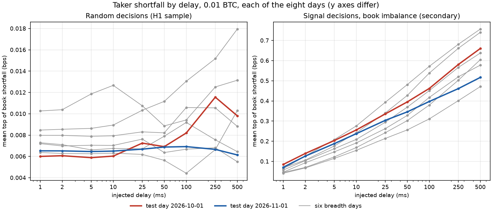
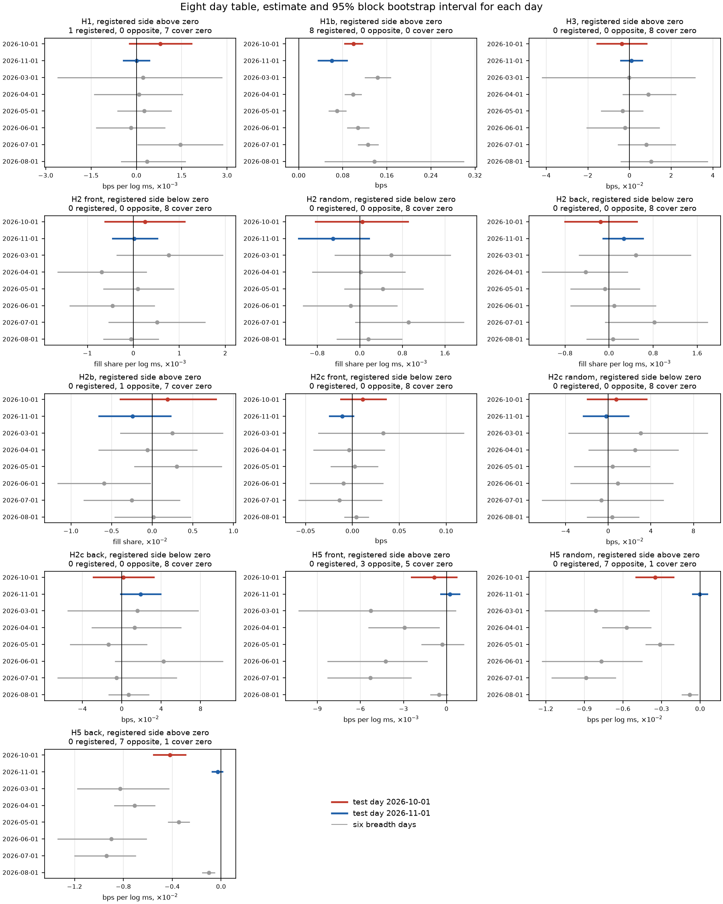

# From Signal to Fill. Final report (draft for review)

## Bottom line
On Binance BTCUSDT perpetual data, I found no measurable cost of delay for decisions made at random moments. That holds for taker orders and for passive orders under all three cancellation rules, on both registered test days. Both primary tests, H1 and H2, are null. Where delay did cost something was an order that acts on a signal. A taker trading on top of book imbalance paid about 0.085<!--c:td1001.sig.S1--> bps at 1 ms and 0.66<!--c:td1001.sig.S500--> bps at 500 ms on 2026-10-01, and 0.071<!--c:td1101.sig.S1--> and 0.52<!--c:td1101.sig.S500--> bps on 2026-11-01. That was not a registered primary test, so I report it as the clearest secondary result and nothing more.

This is a simulation with injected delay on three free crypto days plus six more first of month days. It cannot say anything about real routing speed, other venues or other kinds of day.

## What I tested
The question is in [PROPOSAL.md](PROPOSAL.md) and the pass and fail rules are in [PREREGISTRATION.md](PREREGISTRATION.md), committed before any test day was downloaded. I replayed the same decision at nine delays from 1 ms to 500 ms against recorded top of book, five level and trade data, so market conditions are identical across delays by construction. After the gap rule there are 8,443<!--c:td1001.n--> random decisions on 2026-10-01 and 8,323<!--c:td1101.n--> on 2026-11-01.

## Quant section
Every number below comes from a file under `results/`, and `make verify` checks each one against its file. The figures are drawn from the same files by `python -m s2f.figures` (or `make figures`) and nothing else.

**H1 primary (taker, five level walk).** Null on both days. The slope on log delay is 0.00079<!--c:td1001.h1.slope--> bps per log ms on 2026-10-01 (interval negative 0.00021<!--c:td1001.h1.slope.lo--> to 0.00183<!--c:td1001.h1.slope.hi-->) and 0.0000044<!--c:td1101.h1.slope--> on 2026-11-01 (negative 0.00041<!--c:td1101.h1.slope.lo--> to 0.00042<!--c:td1101.h1.slope.hi-->). The mean extra shortfall at 500 ms is 0.0038<!--c:td1001.h1.dS500--> bps on 2026-10-01 and negative 0.0004<!--c:td1101.h1.dS500--> bps on 2026-11-01, far below the 0.1 bps bar on both days.

**H2 primary (passive fill probability).** Null on both days under front, random and back cancellation. All six intervals cover zero.

| Day | Front | Random | Back |
|---|---|---|---|
| 2026-10-01 | 0.00025<!--c:td1001.h2.front--> (negative 0.00061<!--c:td1001.h2.front.lo--> to 0.00112<!--c:td1001.h2.front.hi-->) | 0.00004<!--c:td1001.h2.random--> (negative 0.00083<!--c:td1001.h2.random.lo--> to 0.00091<!--c:td1001.h2.random.hi-->) | negative 0.00015<!--c:td1001.h2.back--> (negative 0.00080<!--c:td1001.h2.back.lo--> to 0.00051<!--c:td1001.h2.back.hi-->) |
| 2026-11-01 | 0.00002<!--c:td1101.h2.front--> (negative 0.00045<!--c:td1101.h2.front.lo--> to 0.00052<!--c:td1101.h2.front.hi-->) | negative 0.00051<!--c:td1101.h2.random--> (negative 0.00115<!--c:td1101.h2.random.lo--> to 0.00018<!--c:td1101.h2.random.hi-->) | 0.00027<!--c:td1101.h2.back--> (negative 0.00010<!--c:td1101.h2.back.lo--> to 0.00062<!--c:td1101.h2.back.hi-->) |

Slope of fill probability on log delay, with the 95% block bootstrap interval. Fill probability at 1 ms runs from 45%<!--c:td1001.fill1.back--> (back) to 71%<!--c:td1001.fill1.front--> (front) on 2026-10-01 and from 22%<!--c:td1101.fill1.back--> to 59%<!--c:td1101.fill1.front--> on 2026-11-01, so the queue rule matters a great deal for the level and not for the slope. Figure 2 shows the flat lines.

**Secondary.**
- *H1b.* Supported by its rule but partly mechanical. Decisions whose 1 s move went their way pay more at 100 ms than the rest, by 0.099<!--c:td1001.h1b--> bps (0.084<!--c:td1001.h1b.lo--> to 0.115<!--c:td1001.h1b.hi-->) on 2026-10-01 and 0.060<!--c:td1101.h1b--> bps (0.036<!--c:td1101.h1b.lo--> to 0.088<!--c:td1101.h1b.hi-->) on 2026-11-01. The 100 ms cost contains part of the 1 s move that defines the groups, so I read this as weak support at most.
- *H2b.* Not supported. Back minus front drop in fill is 0.0019<!--c:td1001.h2b--> (negative 0.0039<!--c:td1001.h2b.lo--> to 0.0079<!--c:td1001.h2b.hi-->) and negative 0.0024<!--c:td1101.h2b--> (negative 0.0065<!--c:td1101.h2b.lo--> to 0.0023<!--c:td1101.h2b.hi-->).
- *H2c.* Not supported. The registered comparison of all fills covers zero under every rule on both days. On decisions that fill at both delays the 10 s markout is better at 500 ms, the opposite of H2c, by 0.062<!--c:td1001.h2cm.front--> to 0.086<!--c:td1001.h2cm.back--> bps on 2026-10-01 and 0.013<!--c:td1101.h2cm.front--> to 0.042<!--c:td1101.h2cm.back--> bps on 2026-11-01, every interval above zero.
- *H3.* Null. High volatility fifth minus the rest at 100 ms is negative 0.0037<!--c:td1001.h3--> bps (negative 0.0155<!--c:td1001.h3.lo--> to 0.0083<!--c:td1001.h3.hi-->) and 0.0009<!--c:td1101.h3--> bps (negative 0.0040<!--c:td1101.h3.lo--> to 0.0061<!--c:td1101.h3.hi-->).
- *H5.* Not supported. On 2026-10-01 the post then cross cost of the fixed price order falls with delay under random (negative 0.0035<!--c:td1001.h5.random--> bps per log ms, negative 0.0050<!--c:td1001.h5.random.lo--> to negative 0.0021<!--c:td1001.h5.random.hi-->) and back (negative 0.0042<!--c:td1001.h5.back-->, negative 0.0055<!--c:td1001.h5.back.lo--> to negative 0.0029<!--c:td1001.h5.back.hi-->), the wrong way for H5, and covers zero under front. On 2026-11-01 it covers zero under all three. Figure 2, bottom row.

**Signal decisions, secondary.** The walk slope on imbalance decisions is 0.090<!--c:td1001.sig.walk--> bps per log ms (0.088<!--c:td1001.sig.walk.lo--> to 0.093<!--c:td1001.sig.walk.hi-->) on 2026-10-01 and 0.070<!--c:td1101.sig.walk--> (0.065<!--c:td1101.sig.walk.lo--> to 0.075<!--c:td1101.sig.walk.hi-->) on 2026-11-01, over 16,448<!--c:td1001.sig.n--> and 4,706<!--c:td1101.sig.n--> decisions. On the six breadth days the slope runs from 0.068<!--c:breadth.sig.walk.min--> to 0.113<!--c:breadth.sig.walk.max-->, and the mean top of book shortfall goes from between 0.04<!--c:breadth.sig.S1.min--> and 0.07<!--c:breadth.sig.S1.max--> bps at 1 ms to between 0.47<!--c:breadth.sig.S500.min--> and 0.76<!--c:breadth.sig.S500.max--> bps at 500 ms. These decisions overlap and bunch in time. On the dev day the 1 ms baseline often filled at a touch that a faster trader would likely have taken first, so I read the size as an upper end. Figure 1 sets them next to the random decisions.

*Figure 1.* Random decisions on the left, signal decisions on the right. The y axes differ by about two orders of magnitude.

**Breadth, eight days.** The two test days and six more first of month days, read by the rule committed in 1a87f6e before any breadth day was run. Counts are days with the interval on the registered side, on the opposite side, and covering zero. Verdicts on H1 to H5 come only from the two test days.

| Statistic | Registered side | Opposite | Covers zero |
|---|---|---|---|
| H1 | 1<!--c:breadth.h1.reg--> | 0<!--c:breadth.h1.opp--> | 7<!--c:breadth.h1.zero--> |
| H1b | 8<!--c:breadth.h1b.reg--> | 0<!--c:breadth.h1b.opp--> | 0<!--c:breadth.h1b.zero--> |
| H3 | 0<!--c:breadth.h3.reg--> | 0<!--c:breadth.h3.opp--> | 8<!--c:breadth.h3.zero--> |
| H2 front | 0<!--c:breadth.h2front.reg--> | 0<!--c:breadth.h2front.opp--> | 8<!--c:breadth.h2front.zero--> |
| H2 random | 0<!--c:breadth.h2random.reg--> | 0<!--c:breadth.h2random.opp--> | 8<!--c:breadth.h2random.zero--> |
| H2 back | 0<!--c:breadth.h2back.reg--> | 0<!--c:breadth.h2back.opp--> | 8<!--c:breadth.h2back.zero--> |
| H2b | 0<!--c:breadth.h2b.reg--> | 1<!--c:breadth.h2b.opp--> | 7<!--c:breadth.h2b.zero--> |
| H2c front | 0<!--c:breadth.h2cfront.reg--> | 0<!--c:breadth.h2cfront.opp--> | 8<!--c:breadth.h2cfront.zero--> |
| H2c random | 0<!--c:breadth.h2crandom.reg--> | 0<!--c:breadth.h2crandom.opp--> | 8<!--c:breadth.h2crandom.zero--> |
| H2c back | 0<!--c:breadth.h2cback.reg--> | 0<!--c:breadth.h2cback.opp--> | 8<!--c:breadth.h2cback.zero--> |
| H5 front | 0<!--c:breadth.h5front.reg--> | 3<!--c:breadth.h5front.opp--> | 5<!--c:breadth.h5front.zero--> |
| H5 random | 0<!--c:breadth.h5random.reg--> | 7<!--c:breadth.h5random.opp--> | 1<!--c:breadth.h5random.zero--> |
| H5 back | 0<!--c:breadth.h5back.reg--> | 7<!--c:breadth.h5back.opp--> | 1<!--c:breadth.h5back.zero--> |

The one H1 day on the registered side is 2026-07-01, at 0.0015<!--c:breadth.h1.0701--> (0.00004<!--c:breadth.h1.0701.lo--> to 0.0029<!--c:breadth.h1.0701.hi-->). The H2c rows use the registered comparison of all fills. The matched comparison, which went the other way on both test days, isn't in this table.

*Figure 3.* One panel per row of the table above, test days in colour.

*Figure 2.* Top row, the repricing passive order behind H2. Bottom row, the fixed price order behind H5.

**Placebos.** Shuffling each decision's delay labels, as registered, gives intervals that cover zero for H1 on both days and for H2 under all three rules on both days, so the placebo passes by the rule in the Deviation of 2026-11-20. The unshuffled slopes in the placebo files match the passive files exactly. On the dev day the H2 placebo was rerun over 200<!--c:placebo2cal.n--> shuffles as an exploratory check, and under each rule the share of intervals that miss zero sat inside the bound fixed before that run (Figure 5).

*Figure 4.* Filled markers are the real slopes, open squares the placebo.

*Figure 5.* Dev day only. The dashed line is the registered shuffle.

**Robustness.** Fees, 15 minute blocks, 1 BTC orders and local capture order leave every H1 and H2 interval covering zero on both days. Three intervals out of all the horizon lines miss zero, and none of them holds across rules or days. One is the H2 fill slope under random at a 60 s horizon on 2026-11-01, negative 0.00068<!--c:td1101.hz60.random--> (negative 0.00120<!--c:td1101.hz60.random.lo--> to negative 0.00015<!--c:td1101.hz60.random.hi-->). I don't read anything into them.

**Exploratory.** The fixed price arm without orders that are marketable on arrival came out positive on both test days under every rule, from 0.0010<!--c:td1101.fpx.back--> to 0.0058<!--c:td1001.fpx.front--> bps per log ms. Which decisions drop depends on delay, so the kept set isn't the same population across delays. It is a candidate for later work and not a result here.

## My inference, not published
A random decision that reprices on arrival has little to lose to delay, so the nulls are what I would expect. The signal result is the case where an order knows something that decays. That reading is mine and I have not tested it against a model.

## What the literature says
The sources are in [LITERATURE_REVIEW.md](LITERATURE_REVIEW.md), with how deeply I read each one. The nearest work uses proprietary data or optimised strategies, so the question of a paired delay replay on public data is not found in this review, which is a weaker claim than saying nobody has done it.

## Honesty box
- Days. Two test days and six breadth days, all first of month, two on weekends. One 2012 equity day for the order lifecycle part.
- The first start on 2026-10-01 was cut off by the machine. I reran it once. Steps after the cut ran only in parts, and the only check that one process gives the same answer is the dev day dry run.
- The breadth gap rule used count times longest gap as an upper bound, not the real total.
- No second reader has checked the write up yet. A cold review is owed before release.
- A few numbers in older notebook entries were worked out by hand or come from runs whose output wasn't kept. They are marked as not checked against a file, and the notebook entry of 2026-11-21 lists them.
- Not available. Real decision timestamps, order IDs for BTCUSDT, and more than one free day a month. More days, a second venue and queue data would tighten every conclusion.
