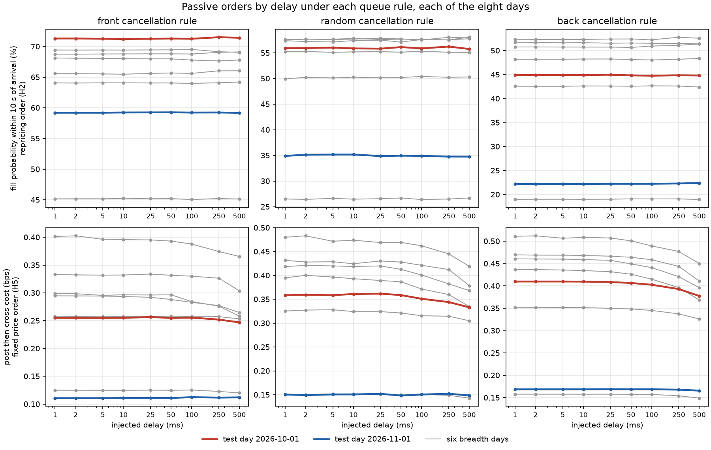
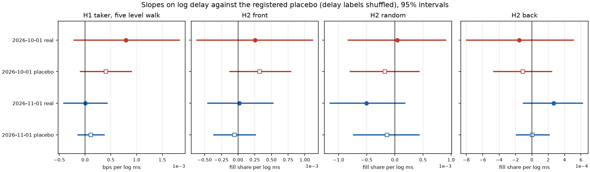
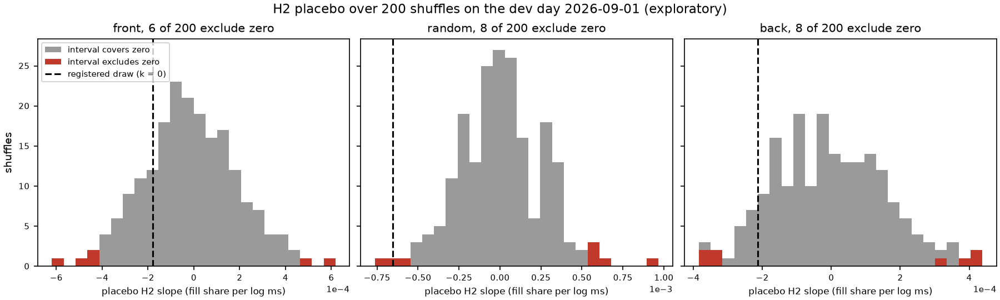

# From Signal to Fill. Final report (draft)

## Bottom line
On Binance BTCUSDT perpetual data, both primary tests are null on both registered test days. H1 is the taker test and H2 the passive test, run under all three cancellation rules. That is not a finding that delay costs nothing. The decisions in both tests come at random moments and the order reads the book again when it arrives, so its expected cost of delay is close to zero by construction. I wrote that in the Deviation of 2026-11-18, before any test day, and said I would put it next to the results. So these nulls only show that the replay doesn't invent a cost. They can't tell whether latency matters.

Where delay did cost something was an order that acts on a signal. A taker trading on top of book imbalance paid a mean top of book shortfall of about 0.085<!--c:td1001.sig.S1--> bps at 1 ms and 0.66<!--c:td1001.sig.S500--> bps at 500 ms on 2026-10-01, and 0.071<!--c:td1101.sig.S1--> and 0.52<!--c:td1101.sig.S500--> bps on 2026-11-01. That was not a registered primary test, so it is a secondary result, and its size is an upper end. The replay has no race for liquidity, and at 1 ms the touch showed less than my order on 47%<!--c:td1001.sig.flagtop1--> of these decisions on 2026-10-01 and 35%<!--c:td1101.sig.flagtop1--> on 2026-11-01. So the fast baseline often fills at a price a faster trader would likely have taken first.

H4, the registered test on real Nasdaq order lifecycles from one day in 2012, is null too. A broker's paper trading venue took a median 255.9<!--c:latency.p50--> ms to acknowledge an order sent from my machine, close to the 250 ms point on my grid, but that is a different venue and not Binance.

This is a simulation with injected delay on three free crypto days plus six more first of month days. It cannot say anything about real routing speed, other venues or other kinds of day.

## What I tested
The question is in [PROPOSAL.md](PROPOSAL.md) and the pass and fail rules are in [PREREGISTRATION.md](PREREGISTRATION.md), committed before any test day was downloaded. I replayed the same decision at nine delays from 1 ms to 500 ms against recorded top of book, five level and trade data, so market conditions are identical across delays by construction. After the gap rule there are 8,443<!--c:td1001.n--> random decisions on 2026-10-01 and 8,323<!--c:td1101.n--> on 2026-11-01. The preregistration also has a regression on real Nasdaq order lifecycles (RQ2, H4) and a timing of real orders through a broker's paper account. Both are reported below.

## Quant section
Every number below comes from a file under `results/`, and `make verify` checks each one against its file. The figures are drawn from the same files by `python -m s2f.figures` (or `make figures`) and nothing else.

**H1 primary (taker, five level walk).** Null on both days. The slope on log delay is 0.00079<!--c:td1001.h1.slope--> bps per log ms on 2026-10-01 (interval negative 0.00021<!--c:td1001.h1.slope.lo--> to 0.00183<!--c:td1001.h1.slope.hi-->) and 0.0000044<!--c:td1101.h1.slope--> on 2026-11-01 (negative 0.00041<!--c:td1101.h1.slope.lo--> to 0.00042<!--c:td1101.h1.slope.hi-->). The mean extra shortfall at 500 ms is 0.0038<!--c:td1001.h1.dS500--> bps on 2026-10-01 and negative 0.0004<!--c:td1101.h1.dS500--> bps on 2026-11-01, far below the 0.1 bps bar on both days. As the Deviation of 2026-11-18 says, an order placed at a random moment that reprices on arrival has close to zero expected latency cost by construction. So this null does not tell us whether latency matters. It only confirms the replay does not invent a cost.

**H2 primary (passive fill probability).** Null on both days under front, random and back cancellation. All six intervals cover zero. The same Deviation applies. The order joins whatever best it finds on arrival, which is just another random moment, so a flat fill probability is what the design gives whether or not queue position matters.

| Day | Front | Random | Back |
|---|---|---|---|
| 2026-10-01 | 0.00025<!--c:td1001.h2.front--> (negative 0.00061<!--c:td1001.h2.front.lo--> to 0.00112<!--c:td1001.h2.front.hi-->) | 0.00004<!--c:td1001.h2.random--> (negative 0.00083<!--c:td1001.h2.random.lo--> to 0.00091<!--c:td1001.h2.random.hi-->) | negative 0.00015<!--c:td1001.h2.back--> (negative 0.00080<!--c:td1001.h2.back.lo--> to 0.00051<!--c:td1001.h2.back.hi-->) |
| 2026-11-01 | 0.00002<!--c:td1101.h2.front--> (negative 0.00045<!--c:td1101.h2.front.lo--> to 0.00052<!--c:td1101.h2.front.hi-->) | negative 0.00051<!--c:td1101.h2.random--> (negative 0.00115<!--c:td1101.h2.random.lo--> to 0.00018<!--c:td1101.h2.random.hi-->) | 0.00027<!--c:td1101.h2.back--> (negative 0.00010<!--c:td1101.h2.back.lo--> to 0.00062<!--c:td1101.h2.back.hi-->) |

Slope of fill probability on log delay, with the 95% block bootstrap interval. Fill probability at 1 ms runs from 45%<!--c:td1001.fill1.back--> (back) to 71%<!--c:td1001.fill1.front--> (front) on 2026-10-01 and from 22%<!--c:td1101.fill1.back--> to 59%<!--c:td1101.fill1.front--> on 2026-11-01, so the queue rule matters a great deal for the level and not for the slope. Figure 2 shows the flat lines.

**Secondary.**
- *H1b.* Supported by its rule but partly mechanical. Decisions whose 1 s move went their way pay more at 100 ms than the rest, by 0.099<!--c:td1001.h1b--> bps (0.084<!--c:td1001.h1b.lo--> to 0.115<!--c:td1001.h1b.hi-->) on 2026-10-01 and 0.060<!--c:td1101.h1b--> bps (0.036<!--c:td1101.h1b.lo--> to 0.088<!--c:td1101.h1b.hi-->) on 2026-11-01. The 100 ms cost contains part of the 1 s move that defines the groups, so I read this as weak support at most. Split B, exploratory and written before the test days, sets the groups by the move from 100 ms to 1.1 s after the decision, which shares no price change with the cost. The gap shrinks to 0.030<!--c:td1001.h1bB--> bps (0.015<!--c:td1001.h1bB.lo--> to 0.044<!--c:td1001.h1bB.hi-->) and 0.020<!--c:td1101.h1bB--> bps (0.009<!--c:td1101.h1bB.lo--> to 0.033<!--c:td1101.h1bB.hi-->) but stays above zero, so not all of H1b is mechanical.
- *H2b.* Not supported. Back minus front drop in fill is 0.0019<!--c:td1001.h2b--> (negative 0.0039<!--c:td1001.h2b.lo--> to 0.0079<!--c:td1001.h2b.hi-->) and negative 0.0024<!--c:td1101.h2b--> (negative 0.0065<!--c:td1101.h2b.lo--> to 0.0023<!--c:td1101.h2b.hi-->).
- *H2c.* Not supported. The registered comparison of all fills covers zero under every rule on both days. On decisions that fill at both delays the 10 s markout is better at 500 ms, the opposite of H2c, by 0.062<!--c:td1001.h2cm.front--> to 0.086<!--c:td1001.h2cm.back--> bps on 2026-10-01 and 0.013<!--c:td1101.h2cm.front--> to 0.042<!--c:td1101.h2cm.back--> bps on 2026-11-01, every interval above zero. H2c is my own inference from Yueshen (2026), not something the paper states (Deviation of 2026-11-18), so this tests my reading of it and not the paper.
- *H3.* Null. High volatility fifth minus the rest at 100 ms is negative 0.0037<!--c:td1001.h3--> bps (negative 0.0155<!--c:td1001.h3.lo--> to 0.0083<!--c:td1001.h3.hi-->) and 0.0009<!--c:td1101.h3--> bps (negative 0.0040<!--c:td1101.h3.lo--> to 0.0061<!--c:td1101.h3.hi-->). The same split by |I| covers zero on both days. The registered tail share, the worst tenth of decisions as a share of total 100 ms cost, comes out at 5.8<!--c:td1001.tail--> and 5.2<!--c:td1101.tail-->. A share above one only means the total is close to zero, so it says nothing about a tail here.
- *H4, real order lifecycles (RQ2, LOBSTER).* Null by its registered rule. On Nasdaq INTC and MSFT on 2012-06-21, a longer rest before the first fill goes with a worse 1 s markout for the resting order before controls. The coefficient on log rest time is negative 0.082<!--c:rq2.INTC.bare--> bps (INTC, interval negative 0.107<!--c:rq2.INTC.bare.lo--> to negative 0.056<!--c:rq2.INTC.bare.hi-->) and negative 0.043<!--c:rq2.MSFT.bare--> (MSFT, negative 0.066<!--c:rq2.MSFT.bare.lo--> to negative 0.019<!--c:rq2.MSFT.bare.hi-->). With spread, displayed size, imbalance, volatility and half hour in the regression it shrinks to negative 0.013<!--c:rq2.INTC.ctrl--> (negative 0.040<!--c:rq2.INTC.ctrl.lo--> to 0.015<!--c:rq2.INTC.ctrl.hi-->) and negative 0.003<!--c:rq2.MSFT.ctrl--> (negative 0.029<!--c:rq2.MSFT.ctrl.lo--> to 0.023<!--c:rq2.MSFT.ctrl.hi-->), both covering zero. The preregistration counts a coefficient that loses its sign after controls as a null. Orders that joined an existing best give the same, negative 0.010<!--c:rq2.INTC.joined--> and negative 0.003<!--c:rq2.MSFT.joined-->. Samples are 20,418<!--c:rq2.INTC.n--> and 20,765<!--c:rq2.MSFT.n--> orders. This is one Nasdaq day in 2012 and describes that day only.

**Signal decisions, secondary.** A decision fires when top of book imbalance passes the threshold fixed on the dev day, on the side the imbalance points. The walk slope on these decisions is 0.090<!--c:td1001.sig.walk--> bps per log ms (0.088<!--c:td1001.sig.walk.lo--> to 0.093<!--c:td1001.sig.walk.hi-->) on 2026-10-01 and 0.070<!--c:td1101.sig.walk--> (0.065<!--c:td1101.sig.walk.lo--> to 0.075<!--c:td1101.sig.walk.hi-->) on 2026-11-01, over 16,448<!--c:td1001.sig.n--> and 4,706<!--c:td1101.sig.n--> decisions. The shortfall numbers in the bottom line are the top of book fill, not the walk. Under that fill the mean is 0.58<!--c:td1001.sig.S250--> and 0.46<!--c:td1101.sig.S250--> bps at 250 ms. On the six breadth days the walk slope runs from 0.068<!--c:breadth.sig.walk.min--> to 0.113<!--c:breadth.sig.walk.max-->, and the mean top of book shortfall goes from between 0.04<!--c:breadth.sig.S1.min--> and 0.07<!--c:breadth.sig.S1.max--> bps at 1 ms to between 0.47<!--c:breadth.sig.S500.min--> and 0.76<!--c:breadth.sig.S500.max--> bps at 500 ms. Figure 1 sets them next to the random decisions.

I read the size as an upper end, for two reasons. The replay has no race, so the 1 ms order never loses the touch to someone faster. And the 1 ms baseline is thin. At 1 ms the touch showed less than the 0.01 BTC order on 47%<!--c:td1001.sig.flagtop1--> of signal decisions on 2026-10-01 and 35%<!--c:td1101.sig.flagtop1--> on 2026-11-01, and even the five level walk ran out of shares on 39%<!--c:td1001.sig.flagwalk1--> and 26%<!--c:td1101.sig.flagwalk1-->. By 500 ms the touch is short on only 0.5%<!--c:td1001.sig.flagtop500--> and 0.4%<!--c:td1101.sig.flagtop500-->. So the thin touch flatters the 1 ms cost much more than the 500 ms cost, which steepens the slope. The walk adds its own bias. It takes the touch first and then snapshot levels strictly worse than it, and prices whatever five levels can't fill at the last level used. At short delays the five level snapshot can lag the touch, so a stale thin level often ends up pricing the rest. These decisions also overlap and bunch in time, and intervals from 5 minute blocks may be too narrow for that.

**Decision to acknowledgement on one real retail stack.** As registered, I sent 200<!--c:latency.orders--> limit buy orders that could not fill to Alpaca's paper crypto venue from this project's machine, and timed each from just before the request to the response. All 200<!--c:latency.acked--> were acknowledged, with 0<!--c:latency.failures--> failures. The median was 255.9<!--c:latency.p50--> ms, the 90th percentile 283.3<!--c:latency.p90--> ms and the 99th 360.0<!--c:latency.p99--> ms. This is a path to a broker's paper venue, not to Binance's matching engine, and nothing like a colocated setup. It also leaves out the time from a signal to my own code sending. No fill, price or cost from it is used anywhere. It only marks where one retail setup would sit on the grid, near the 250 ms point.

*Figure 1.* Random decisions on the left, signal decisions on the right. The y axes differ by about two orders of magnitude.

**Breadth, eight days.** The two test days and six more first of month days, read by the rule committed in 1a87f6e before any breadth day was run. Counts are days with the interval on the registered side, on the opposite side, and covering zero. Verdicts on H1 to H5 come only from the two test days.

| Statistic | Registered side | Opposite | Covers zero |
|---|---|---|---|
| H1 | 1<!--c:breadth.h1.reg--> | 0<!--c:breadth.h1.opp--> | 7<!--c:breadth.h1.zero--> |
| H1b | 8<!--c:breadth.h1b.reg--> | 0<!--c:breadth.h1b.opp--> | 0<!--c:breadth.h1b.zero--> |
| H3 | 0<!--c:breadth.h3.reg--> | 0<!--c:breadth.h3.opp--> | 8<!--c:breadth.h3.zero--> |
| H2 front | 0<!--c:breadth.h2front.reg--> | 0<!--c:breadth.h2front.opp--> | 8<!--c:breadth.h2front.zero--> |
| H2 random | 0<!--c:breadth.h2random.reg--> | 0<!--c:breadth.h2random.opp--> | 8<!--c:breadth.h2random.zero--> |
| H2 back | 0<!--c:breadth.h2back.reg--> | 0<!--c:breadth.h2back.opp--> | 8<!--c:breadth.h2back.zero--> |
| H2b | 0<!--c:breadth.h2b.reg--> | 1<!--c:breadth.h2b.opp--> | 7<!--c:breadth.h2b.zero--> |
| H2c front | 0<!--c:breadth.h2cfront.reg--> | 0<!--c:breadth.h2cfront.opp--> | 8<!--c:breadth.h2cfront.zero--> |
| H2c random | 0<!--c:breadth.h2crandom.reg--> | 0<!--c:breadth.h2crandom.opp--> | 8<!--c:breadth.h2crandom.zero--> |
| H2c back | 0<!--c:breadth.h2cback.reg--> | 0<!--c:breadth.h2cback.opp--> | 8<!--c:breadth.h2cback.zero--> |
| H5 front | 0<!--c:breadth.h5front.reg--> | 3<!--c:breadth.h5front.opp--> | 5<!--c:breadth.h5front.zero--> |
| H5 random | 0<!--c:breadth.h5random.reg--> | 7<!--c:breadth.h5random.opp--> | 1<!--c:breadth.h5random.zero--> |
| H5 back | 0<!--c:breadth.h5back.reg--> | 7<!--c:breadth.h5back.opp--> | 1<!--c:breadth.h5back.zero--> |

The one H1 day on the registered side is 2026-07-01, at 0.0015<!--c:breadth.h1.0701--> (0.00004<!--c:breadth.h1.0701.lo--> to 0.0029<!--c:breadth.h1.0701.hi-->). The H2c rows use the registered comparison of all fills. The matched comparison, which went the other way on both test days, isn't in this table. By the rule, H1b reads consistent and H5 contradicted under all three queue rules. Every other row reads mixed. For H2, H2c and H3 that only means no day sits on either side.

*Figure 3.* One panel per row of the table above, test days in colour.

*Figure 2.* Top row, the repricing passive order behind H2. Bottom row, the fixed price order behind H5.

**Placebos.** Shuffling each decision's delay labels, as registered, gives intervals that cover zero for H1 on both days and for H2 under all three rules on both days, so the placebo passes by the rule in the Deviation of 2026-11-20. The unshuffled slopes in the placebo files match the passive files exactly. On the dev day the H2 placebo was rerun over 200<!--c:placebo2cal.n--> shuffles as an exploratory check, and under each rule the share of intervals that miss zero sat inside the bound fixed before that run (Figure 5). On the real data the placebo interval is often narrower than the interval on the real slope. That is fine for a check that only asks whether zero is covered, but it means the two can't be compared by eye in Figure 4.

*Figure 4.* Filled markers are the real slopes, open squares the placebo.

*Figure 5.* Dev day only. The dashed line is the registered shuffle.

**Robustness.** Fees, 15 minute blocks, 1 BTC orders and local capture order leave every H1 and H2 interval covering zero on both days. Three intervals out of all the horizon lines miss zero, and none of them holds across rules or days. One is the H2 fill slope under random at a 60 s horizon on 2026-11-01, negative 0.00068<!--c:td1101.hz60.random--> (negative 0.00120<!--c:td1101.hz60.random.lo--> to negative 0.00015<!--c:td1101.hz60.random.hi-->). I don't read anything into them. Flipping the tie rule changed 0%<!--c:td1001.tieflip.taker--> of decision and delay cells in the taker leg on 2026-10-01 and 0%<!--c:td1101.tieflip.taker--> on 2026-11-01, and none in either passive leg under any rule. Random decision times are drawn in microseconds and stamps are whole milliseconds, so the flip almost never has a tie to act on. As the Deviation of 2026-11-18 expected, it is not a real check on these decisions.

**Exploratory, written after the dev look.** H5 and the fixed price arm behind it were added after I had looked at the dev day, so they were registered as exploratory and are reported that way.
- *H5, fixed price passive.* Not supported. On 2026-10-01 the post then cross cost of the fixed price order falls with delay under random (negative 0.0035<!--c:td1001.h5.random--> bps per log ms, negative 0.0050<!--c:td1001.h5.random.lo--> to negative 0.0021<!--c:td1001.h5.random.hi-->) and back (negative 0.0042<!--c:td1001.h5.back-->, negative 0.0055<!--c:td1001.h5.back.lo--> to negative 0.0029<!--c:td1001.h5.back.hi-->), the wrong way for H5, and covers zero under front. On 2026-11-01 it covers zero under all three. The sign has a reason inside the replay. An order whose fixed price the book has moved through by the time it arrives fills as a taker at a touch that has already moved its way. That is a free option, which a live order would usually lose to someone faster, and on the dev day those orders carried the whole fall. So the falling cost comes from the race free replay and isn't a fact about markets. Fixed price fill probability does fall with delay on 2026-10-01, the one place random decisions show a stale price effect. The slope is below zero under all three rules, front negative 0.0040<!--c:td1001.fpfill.front--> (negative 0.0046<!--c:td1001.fpfill.front.lo--> to negative 0.0034<!--c:td1001.fpfill.front.hi-->), random negative 0.0018<!--c:td1001.fpfill.random--> (negative 0.0024<!--c:td1001.fpfill.random.lo--> to negative 0.0012<!--c:td1001.fpfill.random.hi-->) and back negative 0.00034<!--c:td1001.fpfill.back--> (negative 0.00070<!--c:td1001.fpfill.back.lo--> to negative 0.000003<!--c:td1001.fpfill.back.hi-->). On 2026-11-01 it is below zero under front, negative 0.00081<!--c:td1101.fpfill.front--> (negative 0.00126<!--c:td1101.fpfill.front.lo--> to negative 0.00036<!--c:td1101.fpfill.front.hi-->), covers zero under random, negative 0.00056<!--c:td1101.fpfill.random--> (negative 0.00114<!--c:td1101.fpfill.random.lo--> to 0.00005<!--c:td1101.fpfill.random.hi-->), and is above zero under back, 0.00049<!--c:td1101.fpfill.back--> (0.00021<!--c:td1101.fpfill.back.lo--> to 0.00078<!--c:td1101.fpfill.back.hi-->). This is description, in fill probability per log ms. Figure 2, bottom row.
- *Fixed price without the orders marketable on arrival.* It came out positive on both test days under every rule, from 0.0010<!--c:td1101.fpx.back--> to 0.0058<!--c:td1001.fpx.front--> bps per log ms. Which decisions drop depends on delay, so the kept set isn't the same population across delays. It is a candidate for later work and not a result here.
- *Where cancellations land, LOBSTER.* At the best price in INTC and MSFT, fully cancelled orders sit toward the back of the queue, mean position 0.803<!--c:cancel.INTC.mean--> and 0.790<!--c:cancel.MSFT.mean--> on a scale from the front to the back, and the back rule is the closest of my three. If Binance queues behaved the same, the passive numbers would sit nearer the back end of their range. That is Nasdaq in 2012 and I haven't checked it on crypto.
- *Jump split.* Random decisions never landed just after a jump. Orders placed right after each jump found the touch gone 1 ms later after 21.6%<!--c:td1001.jump.gone1--> of 194<!--c:td1001.jump.n--> jumps on 2026-10-01 and 15.0%<!--c:td1101.jump.gone1--> of 80<!--c:td1101.jump.n--> on 2026-11-01, against 0.07%<!--c:td1001.jump.base1--> and 0.01%<!--c:td1101.jump.base1--> at random moments.

## My inference, not published
The signal result is the case where an order knows something that decays, which is the one place this design can show a cost at all. How much of that cost would survive a real race for the touch is my reading, and I haven't tested it.

## What the literature says
The sources are in [LITERATURE_REVIEW.md](LITERATURE_REVIEW.md), with how deeply I read each one. The nearest work uses proprietary data or optimised strategies, so the question of a paired delay replay on public data is not found in this review, which is a weaker claim than saying nobody has done it.

## Honesty box
- Days. Two test days and six breadth days, all first of month, two on weekends. One 2012 equity day for the order lifecycle part.
- The replay has no race. My order never moves the book and never competes with anyone for the same liquidity in the same millisecond, and its place in the queue is modelled under three rules, not seen.
- Inside one book update the passive engine nets additions and cancellations into one change instead of applying trades, then cancellations, then additions, as the Deviation of 2026-11-18 says.
- A repricing passive order whose price leaves the top five levels counts as unfilled from then on. That happens on about 37%<!--c:td1001.left5--> of decisions on 2026-10-01 and 17%<!--c:td1101.left5--> on 2026-11-01, almost the same at every delay, and it caps fill probability.
- The five level walk reads a snapshot that can lag the touch at short delays. That matters most for the signal decisions.
- Fees are the base tier of 2<!--nc--> and 5<!--nc--> bps read on 2026-11-19 and frozen in the code for the test day runs, not read again on the day as the robustness item says. An active trader pays less. Albers et al. (2025) list a 1.7<!--cite--> bps taker fee for the best public tier.
- The latency number comes from a broker's paper venue over the internet. It is not a Binance number and it is not colocated.
- The full 2026-10-01 run needed about 30<!--nc--> minutes, and the remote worker I run it on stops any job after 20<!--nc-->, so it died inside the robustness checks. I split the runner into fixed stages, cut by step and never by time window, and reran the day once from scratch (dfe8b61). Everything the first start had written came back byte identical. Steps after the cut ran only in stages, and the only check that one process gives the same answer is the dev day dry run.
- The breadth gap rule used count times longest gap as an upper bound, not the real total.
- Nobody outside this project has reviewed the work. I ran a cold review of the report, the READMEs, the notebook, the preregistration and the code against a written checklist on 2026-11-21, apart from the sessions that wrote them, and every change it led to is in the [integrity log](INTEGRITY_LOG.md). What anyone can check without taking my word is the claim check, which ties each number here to its results file, and the commit history of the preregistration. The report stays a draft until one last review before release.
- A few numbers in older notebook entries were worked out by hand or come from runs whose output wasn't kept. They are marked as not checked against a file, and the notebook entry of 2026-11-21 lists them.
- Not available. Real decision timestamps, order IDs for BTCUSDT, and more than one free day a month. More days, a second venue and queue data would tighten every conclusion.
