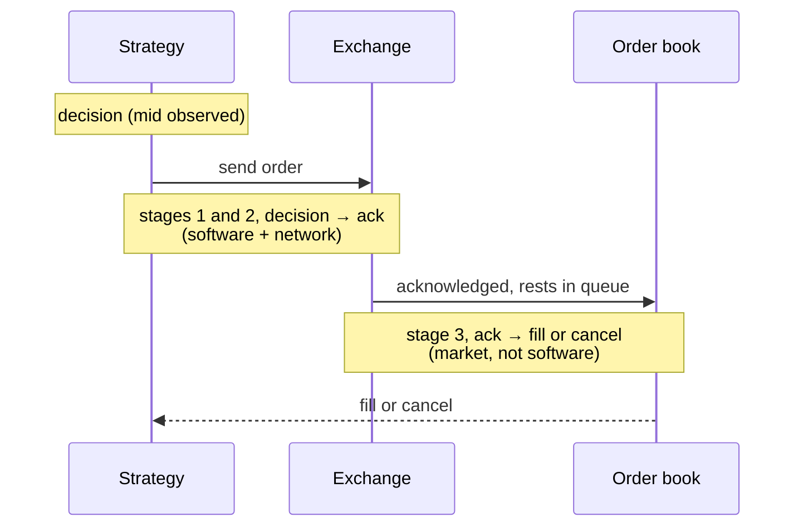

# 01 · From Signal to Fill

> When market conditions are similar, do orders that take longer to reach an outcome receive worse prices or fill less often?

| | |
|---|---|
| Status | 🟡 Preregistered; replay engine built, taker grid next |
| Preregistration | [PREREGISTRATION.md](PREREGISTRATION.md) |
| Proposal | [PROPOSAL.md](PROPOSAL.md) |
| Literature review | [LITERATURE_REVIEW.md](LITERATURE_REVIEW.md) |
| Lab notebook | [LAB_NOTEBOOK.md](LAB_NOTEBOOK.md) |
| Reproduce | `make reproduce` |

## The three stages of delay

## Data
| Source | What | Limits |
|---|---|---|
| [Tardis.dev](https://docs.tardis.dev/downloadable-csv-files) free first of month CSVs | Binance USD-M BTCUSDT top of book, five level snapshots, trades. Dev day 2026-09-01. Test days 2026-10-01 and 2026-11-01 (locked until the preregistration was committed) | One free day a month; millisecond exchange timestamps; no order IDs |
| [LOBSTER samples](https://data.lobsterdata.com/info/DataSamples.php) | Nasdaq AAPL, AMZN, GOOG, INTC, MSFT on 2012-06-21, 10 levels, with order IDs | One old day. No decision timestamps. Only INTC and MSFT have a one tick spread most of the time. Messages outside the 10 level window are missing |

Raw data is not committed. `make data` downloads it.

## Limits (what this cannot show)
- Decision to send latency is injected in simulation, not observed. No public data has decision timestamps.
- Exchange timestamps are in whole milliseconds, so nothing below 1 ms is resolvable.
- The simulator assumes our order does not move the market, and queue position is modelled, not seen.
- The simulated order never races other traders for the same liquidity in the same millisecond.
- Three crypto days and one 2012 equity day. Enough to falsify a claim but not to generalise one.
- The free crypto days are all the first of a month, so any month start effect is baked in.
- A positive result would still not prove faster routing improves trading performance.

## Results
None yet. This section fills only from files in `results/`.
