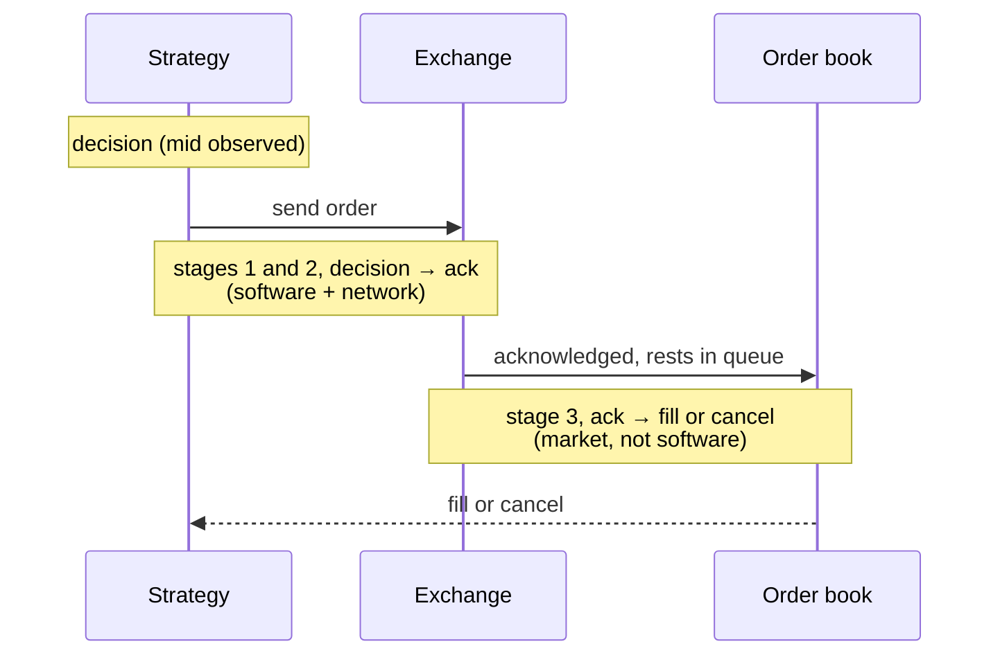

# 01 · From Signal to Fill

> When market conditions are similar, do orders that take longer to reach an outcome receive worse prices or fill less often?

| | |
|---|---|
| Status | 🟡 Test days and breadth days run once on 2026-11-20. H1 and H2 are null on both test days under every cancellation rule, though by design they could hardly be anything else. H4 on the Nasdaq day is null too. A taker acting on book imbalance pays 0.52<!--c:td1101.sig.S500--> to 0.66<!--c:td1001.sig.S500--> bps by 500 ms on the test days, an upper end. Draft report, one last review before release |
| Preregistration | [PREREGISTRATION.md](PREREGISTRATION.md) |
| Proposal | [PROPOSAL.md](PROPOSAL.md) |
| Literature review | [LITERATURE_REVIEW.md](LITERATURE_REVIEW.md) |
| Lab notebook | [LAB_NOTEBOOK.md](LAB_NOTEBOOK.md) |
| Reproduce | `make reproduce` for the dev day work, see [below](#reproducing) for the test days |
| Test day run | `make run_day DAY=2026-10-01` |
| Figures | `make figures` |

## From proposal to experiment
This part isn't in the proposal, which I've kept as written. Public data has no decision timestamps for anyone's orders, so I split the question in two.
1. **Counterfactual replay (simulated):** Take a decision moment from real Binance USD-M BTCUSDT data and replay *the same* decision at several injected delays. Market conditions are identical across delays by construction.
2. **Real order lifecycles (observational):** LOBSTER's Nasdaq message files carry order IDs, so the third stage (acknowledgement to fill or cancel) is observable for real orders, though decision time is not.

The full design and its pass and fail rules are in [PREREGISTRATION.md](PREREGISTRATION.md). Each test day and breadth day runs once with `python -m s2f.run_test_day DATE`. It takes the date and nothing else, refuses any date that isn't registered, and won't run a day whose outputs already exist. Everything that went wrong is in [LAB_NOTEBOOK.md](LAB_NOTEBOOK.md).

## The three stages of delay

## Data
| Source | What | Limits |
|---|---|---|
| [Tardis.dev](https://docs.tardis.dev/downloadable-csv-files) free first of month CSVs | Binance USD-M BTCUSDT top of book, five level snapshots, trades. Dev day 2026-09-01. Test days 2026-10-01 and 2026-11-01 (locked until the preregistration was committed). Breadth days on the first of each month from 2026-03-01 to 2026-08-01, registered under Deviations before any was downloaded | One free day a month; millisecond exchange timestamps; no order IDs |
| [LOBSTER samples](https://php.lobsterdata.com/info/DataSamples.php) | Nasdaq AAPL, AMZN, GOOG, INTC, MSFT on 2012-06-21, 10 levels, with order IDs | One old day. No decision timestamps. Only INTC and MSFT have a one tick spread most of the time. Messages outside the 10 level window are missing |

Raw data isn't committed. `make data` downloads it.

## Limits (what this cannot show)
- Decision to send latency is injected in simulation, not observed. No public data has decision timestamps.
- Exchange timestamps are in whole milliseconds, so nothing below 1 ms is resolvable.
- The simulator assumes my order does not move the market, and queue position is modelled, not seen.
- Inside one book update the passive engine nets additions and cancellations into one change, instead of applying trades, then cancellations, then additions as first written.
- The simulated order never races other traders for the same liquidity in the same millisecond. For signal decisions that makes the 1 ms baseline too kind, so their delay cost is an upper end.
- Nine crypto days (one dev, two test, six breadth) and one 2012 equity day. Enough to knock a claim down, not to show it holds generally.
- The free crypto days are all the first of a month, three of them weekends, so any month start effect is baked in and news days are not covered.
- One venue and one instrument. Nothing here says how another exchange or another queue would behave.
- The first start on 2026-10-01 hit the 20<!--nc--> minute job limit on the remote worker I run it on, so I reran the day from scratch in fixed stages split by step. Only the dev day dry run checks that stages and one process agree.
- Fees are the base tier read on 2026-11-19 and frozen in the code for the test day runs, not read again on the day. An active trader pays less.
- The decision to acknowledgement time was measured on a broker's paper venue over the internet, not on Binance and not colocated.
- A positive result would still not prove faster routing improves trading performance.

## Results
The report is [FINAL_REPORT.md](FINAL_REPORT.md), still a draft. It goes out after one last review. In short, it finds the following.
- H1 and H2, the two primary tests, are null on both test days, and H2 is null under front, random and back cancellation. Random decisions that reprice on arrival have close to zero expected latency cost by construction (Deviation of 2026-11-18), so these nulls can't tell whether latency matters. They show the replay doesn't invent a cost.
- H1b holds by its rule but is partly mechanical. H2b, H2c and H3 are not supported. H2c points the other way on decisions that fill at both delays, while the registered comparison of all fills covers zero everywhere.
- H4, on real Nasdaq order lifecycles from 2012-06-21, is null by its registered rule. The link between rest time and markout loses its sign once controls go in.
- H5, exploratory because I wrote it after the dev look, is not supported. Its cost falls with delay, which comes from orders that can trade on arrival getting a free option in a replay with no race.
- The six breadth days back the test days up. They do not change any verdict, which comes from the test days alone.
- The clearest thing in the data is secondary. A taker acting on top of book imbalance loses roughly half to three quarters of a bp by 500 ms on every one of the eight days. That is an upper end, since the replay has no race and at 1 ms the touch is smaller than the order on 35%<!--c:td1101.sig.flagtop1--> to 47%<!--c:td1001.sig.flagtop1--> of these decisions on the test days. Random decisions lose almost nothing. Their H1 interval sits above zero on one day of the eight, and the slope there is tiny.
- Orders sent to a broker's paper crypto venue were acknowledged in a median 255.9<!--c:latency.p50--> ms, 90th percentile 283.3<!--c:latency.p90--> ms and 99th 360.0<!--c:latency.p99--> ms, over 200<!--c:latency.orders--> orders. That is a different venue, used only to mark one real retail setup on the delay grid.

The figures are drawn only from files in `results/` by `python -m s2f.figures` and land in [figures/](figures/).

More figures, the eight day table and the placebos, are in the report.

## Reproducing
`make env` builds the pinned environment (Python 3.12, `requirements.lock`) and `make data` downloads the dev day and the LOBSTER samples. `make reproduce` then reruns every dev day analysis, the LOBSTER part, the figures and `make verify`. Seeds are fixed in the code, and the figures come out byte for byte the same.

It does not redo the test days or the breadth days. Their data comes from `python -m s2f.get_data test` and `python -m s2f.get_data breadth`, and each day ran once through `python -m s2f.run_test_day DATE`, which refuses to run a day whose outputs already exist. To rerun one from a clone you have to move that day's committed results out of `results/` first and compare by hand. `make dry_run` does that comparison for the dev day only, and I haven't regenerated the test day files to check them. The broker latency number was a live measurement on 2026-11-19 and can't be rerun to the same values.
