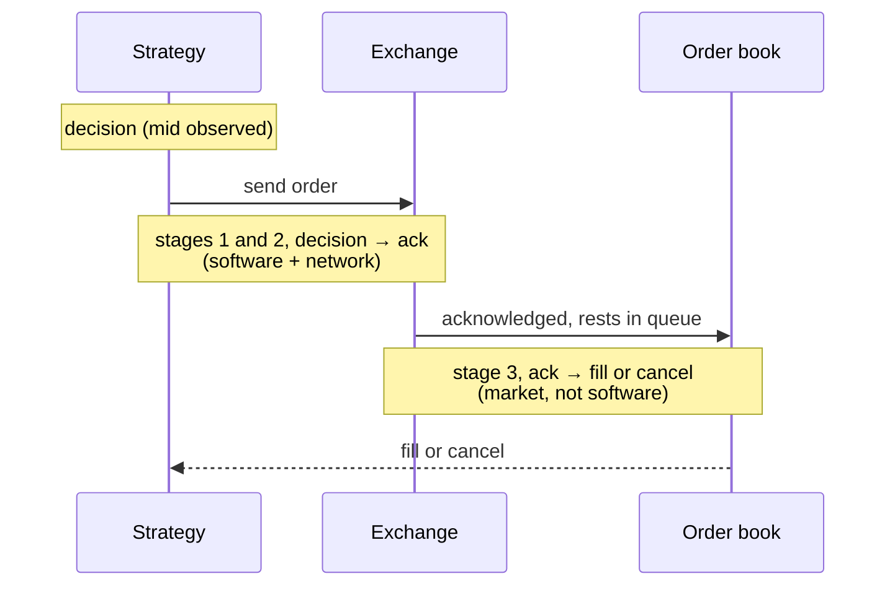
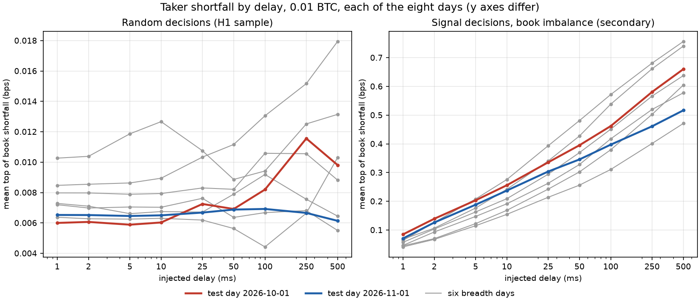
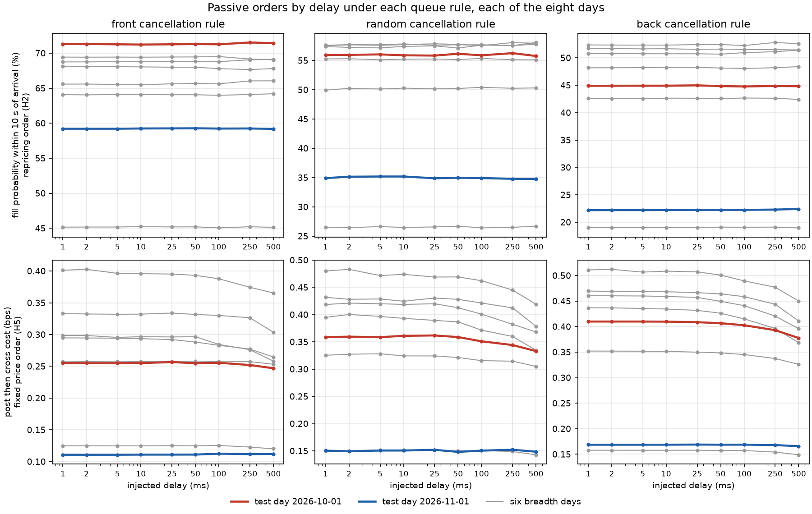

# 01 · From Signal to Fill

> When market conditions are similar, do orders that take longer to reach an outcome receive worse prices or fill less often?

| | |
|---|---|
| Status | 🟡 Test days and breadth days run once on 2026-11-20. H1 and H2 are null on both test days under every cancellation rule. A taker acting on book imbalance pays 0.52<!--c:td1101.sig.S500--> to 0.66<!--c:td1001.sig.S500--> bps by 500 ms on the test days. Draft report written, cold review still to do |
| Preregistration | [PREREGISTRATION.md](PREREGISTRATION.md) |
| Proposal | [PROPOSAL.md](PROPOSAL.md) |
| Literature review | [LITERATURE_REVIEW.md](LITERATURE_REVIEW.md) |
| Lab notebook | [LAB_NOTEBOOK.md](LAB_NOTEBOOK.md) |
| Reproduce | `make reproduce` |
| Test day run | `make run_day DAY=2026-10-01` |
| Figures | `make figures` |

## From proposal to experiment
This part isn't in the proposal, which I've kept as written. Public data has no decision timestamps for anyone's orders, so I split the question in two.
1. **Counterfactual replay (simulated):** Take a decision moment from real Binance USD-M BTCUSDT data and replay *the same* decision at several injected delays. Market conditions are identical across delays by construction.
2. **Real order lifecycles (observational):** LOBSTER's Nasdaq message files carry order IDs, so the third stage (acknowledgement to fill or cancel) is observable for real orders, though decision time is not.

The full design and its pass and fail rules are in [PREREGISTRATION.md](PREREGISTRATION.md). Each test day and breadth day runs once with `python -m s2f.run_test_day DATE`. It takes the date and nothing else, refuses any date that isn't registered, and won't run a day whose outputs already exist. Everything that went wrong is in [LAB_NOTEBOOK.md](LAB_NOTEBOOK.md).

## The three stages of delay

## Data
| Source | What | Limits |
|---|---|---|
| [Tardis.dev](https://docs.tardis.dev/downloadable-csv-files) free first of month CSVs | Binance USD-M BTCUSDT top of book, five level snapshots, trades. Dev day 2026-09-01. Test days 2026-10-01 and 2026-11-01 (locked until the preregistration was committed). Breadth days on the first of each month from 2026-03-01 to 2026-08-01, registered under Deviations before any was downloaded | One free day a month; millisecond exchange timestamps; no order IDs |
| [LOBSTER samples](https://php.lobsterdata.com/info/DataSamples.php) | Nasdaq AAPL, AMZN, GOOG, INTC, MSFT on 2012-06-21, 10 levels, with order IDs | One old day. No decision timestamps. Only INTC and MSFT have a one tick spread most of the time. Messages outside the 10 level window are missing |

Raw data isn't committed. `make data` downloads it.

## Limits (what this cannot show)
- Decision to send latency is injected in simulation, not observed. No public data has decision timestamps.
- Exchange timestamps are in whole milliseconds, so nothing below 1 ms is resolvable.
- The simulator assumes my order does not move the market, and queue position is modelled, not seen.
- The simulated order never races other traders for the same liquidity in the same millisecond. For signal decisions that makes the 1 ms baseline too kind, so their delay cost is an upper end.
- Nine crypto days (one dev, two test, six breadth) and one 2012 equity day. Enough to knock a claim down, not to show it holds generally.
- The free crypto days are all the first of a month, two of them weekends, so any month start effect is baked in and news days are not covered.
- One venue and one instrument. Nothing here says how another exchange or another queue would behave.
- The first start on 2026-10-01 was cut off by the machine and the day was rerun in parts. Only the dev day dry run checks that parts and one process agree.
- A positive result would still not prove faster routing improves trading performance.

## Results
The report is [FINAL_REPORT.md](FINAL_REPORT.md), still a draft until it has had a second reader. In short, it finds the following.
- H1 and H2, the two primary tests, are null on both test days, and H2 is null under front, random and back cancellation.
- H1b holds by its rule but is partly mechanical. H2b, H2c, H3 and H5 are not supported, and H2c and H5 point the other way where they point at all.
- The six breadth days back the test days up. They do not change any verdict, which comes from the test days alone.
- The clearest thing in the data is secondary. A taker acting on top of book imbalance loses roughly half to three quarters of a bp by 500 ms on every one of the eight days. Random decisions lose almost nothing. Their H1 interval sits above zero on one day of the eight, and the slope there is tiny.

The figures are drawn only from files in `results/` by `python -m s2f.figures` and land in [figures/](figures/).

More figures, the eight day table and the placebos, are in the report.
