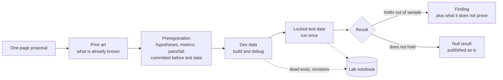

# Proposals

**One research question a week, taken from a one-page proposal to running code.**
Hypotheses are written down before results. Dead ends stay in the log. Null results get published.

*Sohan Hajra · UIUC B.S. Mathematics & Computer Science · [sohanhajra.github.io](https://sohanhajra.github.io)*

## How each proposal is run

## The proposals

| # | Proposal | The question | Status | Headline |
|---|---|---|---|---|
| 01 | [From Signal to Fill](01-signal-to-fill/) | When market conditions are the same, does extra delay between decision and order outcome cost price or fills? | 🟡 In progress, data audited | No result yet |

<b>01 · From Signal to Fill</b>: what I believed, what I tried, what broke, what I believe now

**What I believed.** Latency costs takers through price drift and costs makers through lost queue position.

**What I tried.** Turned the proposal into two arms: replaying the *same* decision moment at controlled delays on public Binance BTCUSDT data, and real order lifecycles from Nasdaq LOBSTER samples.

**What broke.** LOBSTER's main site serves an HTML shell where sample zips used to be. A 2025 live-trading study on Binance and Bybit turned out to be close to my first research question, so I narrowed what I claim is new.

**What I believe now.** BTCUSDT's spread is one tick on 95.5% of book updates, so the passive side is where delay should matter most. Updated daily in the [lab notebook](01-signal-to-fill/LAB_NOTEBOOK.md).

## Rules this repo holds itself to
- Every number comes from code in the repo, rerunnable with `make reproduce` (pinned environment, fixed seeds).
- Test data stays locked until the preregistration is committed; the download script refuses otherwise.
- Out-of-sample checks, trading costs and alternative specifications before any claim.
- If a week's proposal isn't good enough, it ships late rather than thin.
