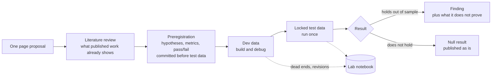

# Proposals

**Research questions, each taken from a one page proposal to running code.**
I write the hypotheses down before I look at any results. Dead ends stay in the log, and a null result gets published like any other.

*Sohan Hajra · UIUC B.S. Mathematics & Computer Science · [sohanhajra.github.io](https://sohanhajra.github.io)*

## How each proposal is run

## The proposals

| # | Proposal | The question | Status | Headline |
|---|---|---|---|---|
| 01 | [From Signal to Fill](01-signal-to-fill/) | When market conditions are the same, does extra delay between decision and order outcome cost price or fills? | 🟡 In progress, preregistered | No result yet |

<b>01 · From Signal to Fill</b> · what I believed, what I tried, what broke, what I believe now

**What I believed.** Latency costs takers through price drift and costs makers through lost queue position.

**What I tried.** I turned the proposal into two arms. One replays the *same* decision moment at controlled delays on public Binance BTCUSDT data, and the other reads real order lifecycles from Nasdaq LOBSTER samples.

**What broke.** LOBSTER's main site serves an HTML shell where sample zips used to be. A 2025 live trading study on Binance and Bybit turned out to be close to my first research question, so I narrowed what I claim is new.

**What I believe now.** I measured that BTCUSDT's spread is one tick on 95.5% of book updates on the dev day. My hypothesis, not yet tested, is that this makes queue position, and so the passive side, where delay should cost most. Full history in the [lab notebook](01-signal-to-fill/LAB_NOTEBOOK.md).

## Rules I hold this repo to
- Every number comes from code in the repo, and `make reproduce` reruns it (pinned environment, fixed seeds).
- Test data stays locked until the preregistration is committed. The download script refuses to fetch it before then.
- No claim before out of sample checks, trading costs and a few alternative specifications.
- A proposal that isn't good enough ships late rather than thin.
- Every result number in a proposal's notes carries a hidden tag that points to the field in the results file it came from. [claimcheck](claimcheck/) rereads those files and fails when a number in the prose and the file disagree. It also checks that every source says how deeply I read it and that the preregistration was committed before any test day result. Run it with `make verify` in a proposal folder. It also runs on every push, and the badge at the top shows the last result. It can't tell whether a result is right, only that the notes report what the code wrote.
- Each proposal keeps an [integrity log](01-signal-to-fill/INTEGRITY_LOG.md). After each work session I go back over the logic, the sources and any bias, and write down what I found and what I fixed.
